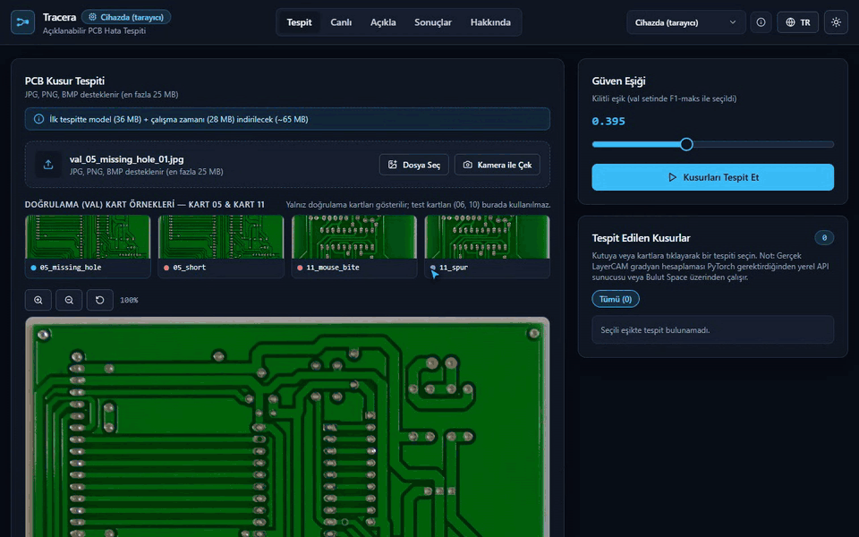
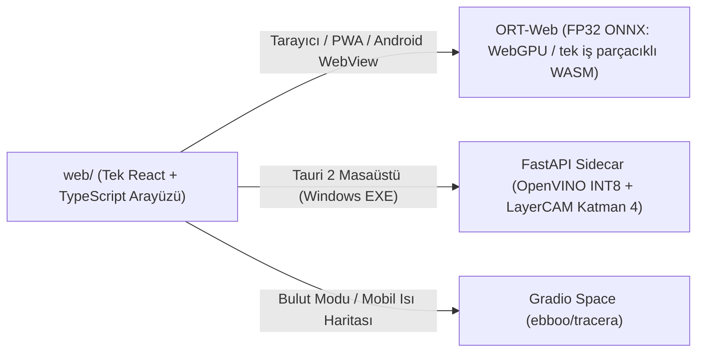

# Tracera: Açıklanabilir ve Edge Uyumlu PCB Hata Tespiti



Tam demo (50 sn): [results/demo/tracera_demo.mp4](results/demo/tracera_demo.mp4)

**Tracera**, baskı devre kartlarındaki (PCB) 6 sınıf üretim kusurunu (**missing_hole**, **mouse_bite**, **open_circuit**, **short**, **spur**, **spurious_copper**) YOLO11s ile tespit eden, kartlar arası genellemeyi kart bazlı bölmeyle ölçen, tespitleri doğrulanmış bir **LayerCAM (Katman 4)** ısı haritasıyla açıklayan ve **OpenVINO INT8 / TensorRT FP16** ile hızlandırılan bir sistemdir.

[](https://github.com/eminburakozturk/tracera/actions/workflows/ci.yml)

> - **Canlı Statik Web Demosu (Tarayıcıda ONNX):** [huggingface.co/spaces/ebboo/tracera-web](https://huggingface.co/spaces/ebboo/tracera-web) *(yayında — tarayıcıda ONNX)*
> - **Bulut Demo & LayerCAM API (Hugging Face Spaces, Gradio):** [huggingface.co/spaces/ebboo/tracera](https://huggingface.co/spaces/ebboo/tracera)
> - **Model Deposu (Hugging Face Hub):** [huggingface.co/ebboo/tracera-model](https://huggingface.co/ebboo/tracera-model) *(last.pt, OpenVINO INT8, FP32 ONNX, meta.json)*
> - **Kurulum Paketleri (GitHub Releases — Windows EXE & Android APK):** [GitHub Releases (eminburakozturk/tracera) — Windows EXE + Android APK](https://github.com/eminburakozturk/tracera/releases)

---

## 1. Başlık Sonuçları

Model seçiminde ve değerlendirmede aşırı iyimser tekil split yanılgısını önlemek amacıyla birincil başlık metriği olarak **kart bazlı 5-katlı çapraz doğrulama (5-Fold Grouped CV)** ortalaması temel alınmıştır:

- **Kart Bazlı 5-Katlı Çapraz Doğrulama (yolo11s @ 1024, last.pt):**
  - **mAP50:** **0.858 ± 0.152** (`0.8575 ± 0.1523`, örneklem $ddof=1$)
  - **mAP50-95:** **0.424 ± 0.119** (`0.4240 ± 0.1188`)
- **Görülmemiş Test Kartları (Tek Seferlik Nihai Değerlendirme — Kart 06 ve 10, 93 görüntü, 469 kusur kutusu):**
  - **mAP50:** **0.9225**
  - **mAP50-95:** **0.4740**
  - **Precision / Recall / F1 (val'de önceden seçilen eşik, conf = 0.395):** 0.7455 / 0.8870 / 0.8101 — ayrıntı ve hata analizi Bölüm 4'te.

> **Metodolojik Not:** Test kartları (06 ve 10), 1024 kart bazlı CV'de en yüksek skoru alan Kat 5'in doğrulama kartları arasındaydı (0.9569 mAP50). Bu yüzden tek seferlik test skoru (0.9225) iyimser uçtadır; projenin ana iddiası **0.858 ± 0.152** CV ortalamasıdır. Ultralytics'in test için otomatik raporladığı P 0.9462 / R 0.8577, eşiği test setinin kendi F1 eğrisinden (0.569) seçtiği için bir üst sınırdır ("oracle eşik") ve başarı olarak raporlanmaz.

> **Platform Paritesi Notu:** Sonuçlar Windows'ta üretildi; Linux Docker testlerinde aynı görüntüde ~0.01 güven farkı gözlendi (ör. 0.8312 → 0.8408); CI Linux parite raporu bu farkı ölçmek için eklendi.

---

## 2. Neden Kart Bazlı Bölme? (Veri Sızıntısı Analizi)

PKU-Market-PCB'nin 693 görüntüsü yalnızca 10 kart fotoğrafından türetilmiştir: her görüntü, bir kartın şablon fotoğrafına sentetik kusurlar eklenerek üretilmiştir. Görüntüler rastgele bölündüğünde aynı kartın görüntüleri hem eğitimde hem doğrulamada yer alır; model, doğrulamada daha önce gördüğü bir kart arka planıyla karşılaşır.

Bunun skoru ne kadar etkilediğini ölçmek için aynı 623 görüntü (test split'i hariç) üzerinde **Rastgele (StratifiedKFold)** ve **Kart Bazlı (GroupKFold, grup = kart numarası)** 5-katlı çapraz doğrulama kıyaslanmıştır (yolo11s, imgsz 640, 60 epoch, seed 42; Bölüm 3'teki çözünürlük deneyinden farklı ayarlar):

| Bölme Şeması | Kat | Doğrulama Kartları | Eğitim / Val Görüntü | mAP50 | mAP50-95 | missing_hole | mouse_bite | open_circuit | short | spur | spurious_copper |
|---|---|---|---|---|---|---|---|---|---|---|---|
| Rastgele (Random Split) | Kat 1 | 01;04;05;06;07;08;09;10;11;12 | 498 / 125 | 0.9416 | 0.5022 | 0.5870 | 0.4556 | 0.5005 | 0.5192 | 0.4492 | 0.5015 |
| Rastgele (Random Split) | Kat 2 | 01;04;05;06;07;08;09;10;11;12 | 498 / 125 | 0.9507 | 0.5088 | 0.5928 | 0.4792 | 0.4567 | 0.5609 | 0.4934 | 0.4695 |
| Rastgele (Random Split) | Kat 3 | 01;04;05;06;07;08;09;10;11;12 | 498 / 125 | 0.9414 | 0.4931 | 0.5493 | 0.5284 | 0.4443 | 0.4794 | 0.4609 | 0.4960 |
| Rastgele (Random Split) | Kat 4 | 01;04;05;06;07;08;09;10;11;12 | 499 / 124 | 0.9185 | 0.4889 | 0.6418 | 0.4503 | 0.4996 | 0.4349 | 0.4428 | 0.4638 |
| Rastgele (Random Split) | Kat 5 | 01;04;05;06;07;08;09;10;11;12 | 499 / 124 | 0.9300 | 0.5009 | 0.6193 | 0.4895 | 0.4850 | 0.4963 | 0.4124 | 0.5029 |
| **Rastgele (Random Split) Ortalama** | **Özet** | **10 Kart (Tümü)** | **623 Toplam** | **0.9364 ± 0.0124** | **0.4988 ± 0.0078** | 0.5980 | 0.4806 | 0.4772 | 0.4981 | 0.4517 | 0.4867 |
|---|---|---|---|---|---|---|---|---|---|---|---|
| Kart Bazlı (Grouped Split) | Kat 1 | 01 | 509 / 114 | 0.5005 | 0.2001 | 0.4456 | 0.1000 | 0.2528 | 0.2163 | 0.0308 | 0.1550 |
| Kart Bazlı (Grouped Split) | Kat 2 | 04;11 | 466 / 157 | 0.8805 | 0.4182 | 0.5331 | 0.4960 | 0.4409 | 0.2381 | 0.3940 | 0.4071 |
| Kart Bazlı (Grouped Split) | Kat 3 | 05;12 | 513 / 110 | 0.8525 | 0.4363 | 0.5571 | 0.4130 | 0.4666 | 0.4960 | 0.4751 | 0.2100 |
| Kart Bazlı (Grouped Split) | Kat 4 | 08;09 | 514 / 109 | 0.8998 | 0.4437 | 0.4765 | 0.3511 | 0.4568 | 0.4380 | 0.4384 | 0.5016 |
| Kart Bazlı (Grouped Split) | Kat 5 | 06;07;10 | 490 / 133 | 0.8974 | 0.4801 | 0.5844 | 0.4613 | 0.4746 | 0.4532 | 0.4475 | 0.4593 |
| **Kart Bazlı (Grouped Split) Ortalama** | **Özet** | **10 Kart (Tümü)** | **623 Toplam** | **0.8061 ± 0.1719** | **0.3957 ± 0.1116** | 0.5193 | 0.3643 | 0.4183 | 0.3683 | 0.3572 | 0.3466 |

> **Deneysel Çıkarım:** Rastgele bölmede mAP50 **0.9364 ± 0.0124** iken, doğrulama kartları eğitimde hiç görülmediğinde **0.8061 ± 0.1719**'a düşmektedir (**−13.0 puan**) ve kartlar arası değişkenlik çok büyüktür. En kötü kat Kat 1'dir (yalnız Kart 01, mAP50 0.5005); Kart 01'in kusur kutuları veri setindeki en küçük kutulardır (640'ta medyan 11.6 px, diğer kartlarda 16–27 px). Sonuç: rastgele bölme, görülmemiş kartlara genellemeyi olduğundan belirgin biçimde iyimser gösterir.

---

## 3. Giriş Çözünürlüğü ve Model Seçimi

Kusurlar ~3000 px genişliğindeki görüntülerde medyan ~64 px'tir; 640'a küçültüldüğünde medyan 13–24 px'e, en küçükleri ~5 px'e iner. Bu yüzden giriş boyutu 640×640 ve 1024×1024 çözünürlüklerinde 5-katlı kart bazlı çapraz doğrulama ile karşılaştırılmıştır:

| Çözünürlük | Ağırlık Kuralı | Kat 1 | Kat 2 | Kat 3 | Kat 4 | Kat 5 | Ortalama ± std (mAP50) | Ortalama ± std (mAP50-95) | Ortalama Süre (dk) |
|---|---|---|---|---|---|---|---|---|---|
| **640x640** | last.pt (Önceden Kilitli) | 0.5155 | 0.8402 | 0.8565 | 0.8192 | 0.9031 | **0.7869 ± 0.1548** | 0.3760 ± 0.1080 | 11.0 dk |
| **640x640** | best.pt (Bilgi Amaçlı Val Seçimi) | 0.5069 | 0.8716 | 0.8921 | 0.9258 | 0.9031 | **0.8199 ± 0.1761** | 0.4040 ± 0.1080 | 11.0 dk |
| **1024x1024** | last.pt (Önceden Kilitli) | 0.5885 | 0.9080 | 0.8952 | 0.9388 | 0.9569 | **0.8575 ± 0.1523** | 0.4240 ± 0.1188 | 24.8 dk |
| **1024x1024** | best.pt (Bilgi Amaçlı Val Seçimi) | 0.6442 | 0.9248 | 0.9295 | 0.9637 | 0.9546 | **0.8834 ± 0.1347** | 0.4508 ± 0.0938 | 24.8 dk |

1024×1024 çözünürlük 5 katın 5'inde de üstünlük sağlamış (last.pt ortalama farkı mAP50 **+0.0706**, mAP50-95 **+0.0480**), bu nedenle nihai model `yolo11s @ 1024` seçilmiştir. Bu CV'de early stopping kapalıydı (80 epoch sabit) ve birincil ağırlık last.pt'dir; best.pt, doğrulama setine göre seçildiği için yalnızca bilgi amaçlı verilmiştir. 1280 çözünürlük ve tiling tek split'te denenip elendi (1280, 1024'ten ayırt edilemedi; tiling çıkarım hattını karmaşıklaştırıyordu).

---

## 4. Çalışma Noktası, Hata Analizi ve Şablon Kontrolü

Nesne tespiti modellerinde mAP eşikten bağımsız bir sıralama metriğidir. Gerçek bir kalite kontrol hattında ise tek bir güven eşiği seçilmelidir. Çalışma noktası protokolü gereğince, güven eşiği **test seti görülmeden önce doğrulama (val) kümesinde F1 skoru maksimize edilerek (conf = 0.395, IoU = 0.50)** kilitlenmiştir.

### Sabit Eşik Performansı ve FP Ayrıştırması

| Veri Kümesi Spliti | Güven Eşiği | TP | Toplam FP | Arka Plan FP (IoU<0.1) | Konum Hatası FP | Çift Tespit FP | Yanlış Sınıf FP | FN | Precision | Recall | F1 Skoru |
|---|---|---|---|---|---|---|---|---|---|---|---|
| Doğrulama (Val: Kart 05, 11) | 0.395 | 514 | 16 | 7 | 7 | 2 | 0 | 48 | 0.9698 | 0.9146 | **0.9414** |
| Test (Kilitli: Kart 06, 10) | 0.395 | 416 | 142 | 125 | 8 | 4 | 5 | 53 | 0.7455 | 0.8870 | **0.8101** |
| **Test (Duyarlılık: 2 Şablon Noktası Hariç)** | 0.395 | 416 | 28 | 11 | 8 | 4 | 5 | 53 | **0.9369** | 0.8870 | **0.9113** |

### Hata Analizi: 2 Sabit Şablon Noktası
Test setindeki 142 yanlış pozitifin (FP) 138'i tek bir kartta (**Kart 06**) kümelenmiştir (Kart 10'da sadece 4 FP vardır).
Bu 138 FP'nin 114'ü, Kart 06'nın neredeyse her test görüntüsünde **aynı 2 sabit koordinatta** tekrarlanmaktadır. Bu noktalarda etiketli bir kusur yoktur (veri seti yalnızca sonradan eklenen sentetik kusurları etiketler):
1. `mouse_bite` @ $(x \approx 1001, y \approx 1380)$: 57 farklı test görüntüsünde 57 kez yanlış alarm vermiştir (güven: 0.44–0.63).
2. `spur` @ $(x \approx 1708, y \approx 1050)$: 57 farklı test görüntüsünde 57 kez yanlış alarm vermiştir (güven: 0.40–0.46).

### Temiz Şablon Kontrolü (Doğrulama)
Hatanın kaynağını doğrulamak için model hatasız şablon kartları üzerinde (`PCB_USED/05, 06, 10, 11.JPG`) çalıştırılmıştır:

| Kart No | Şablon Dosyası | Yanlış Alarm Sınıfı | Model Güveni | Koordinatlar (cx, cy) | Teşhis |
|---|---|---|---|---|---|
| Kart 05 | `05.JPG` | spurious_copper | 0.5108 | (1606.5, 1072.9) | İncelenmedi |
| Kart 05 | `05.JPG` | spurious_copper | 0.4475 | (1537.1, 1183.2) | İncelenmedi |
| Kart 06 | `06.JPG` | mouse_bite | 0.5569 | (1000.6, 1380.1) | **Test FP noktasıyla aynı konum** |

Kart 10 ve 11 şablonlarında hiç yanlış alarm yoktur (4 temiz şablonda toplam 3 alarm).

- **mouse_bite noktası:** Hatasız Kart 06 şablonunda da 0.5569 güvenle alarm verdiği için kaynağı sentetik kusur değil, şablon fotoğrafının kendisidir. Görselde yolda bir daralma gibi görünür; bunun gerçek bir üretim kusuru mu yoksa tasarım detayı mı olduğu bilinmemektedir.
- **spur noktası:** Konum sabittir, ancak temiz şablonda güven yalnızca 0.09'dur; kusurlu görüntülerde neden 0.40–0.46'ya çıktığı açıklanamamıştır (Bölüm 9).

**Duyarlılık satırı:** Bu 2 nokta çıkarıldığında test Precision'ı **0.9369**, F1 **0.9113** olur. Bu satır sonradan yapılmış bir analizdir; kilitli sonuç P 0.7455 / F1 0.8101'dir.

---

## 5. Açıklanabilir Yapay Zeka (XAI) Doğrulama Protokolü

Her tespit için ayrı bir ısı haritası üretilir ve haritanın modele **sadık** olup olmadığı (modelin o kararı verirken gerçekten o bölgeye dayanıp dayanmadığı) test edilir. Üç yöntem aynı protokolle karşılaştırılmıştır (nihai model, val, 150 tespit, seed 42).


*Şekil 1: LayerCAM @ Katman 4 ile üretilen ısı haritası ve 4× yakınlaştırılmış kusur bölgesi (val kümesi Kart 05 missing_hole tespiti).*

### Pointing Game ve Enerji Oranı

| Hedef Katman | Yöntem | Kendi Kutu Pointing (Eğitilmiş) | Pointing (Rastgele Model) | Rastgele Şans Oranı | Pencere Alan Oranı | Kutu İçi Enerji (Pencere İçi) | Taban Kutu Alan Oranı |
|---|---|---|---|---|---|---|---|
| Katman 4 | gradcam | 6.7% | 0.7% | 0.106% | 100.0% | 0.5% | 0.110% |
| Katman 4 | hirescam | 88.0% | 62.0% | 0.106% | 100.0% | 33.7% | 0.110% |
| Katman 4 | layercam | 90.7% | 68.0% | 0.106% | 100.0% | **61.0%** | 0.110% |
| Katman 16 | layercam | 100.0% | 68.0% | 0.106% | 0.2% | 92.9% | 51.960% |

### Mutlak Bütçeli Yapısal Silme Testi (Asıl Sadakat Ölçüsü)

| Hedef Katman | Yöntem | 1x GT Alanı Harita Göreli Düşüş (Ort / Med) | 1x Kontrol Düşüşü (Ort / Med) | 1x Kazanma Oranı | 2x GT Alanı Harita Göreli Düşüş (Ort / Med) | 2x Kontrol Düşüşü (Ort / Med) | 2x Kazanma Oranı |
|---|---|---|---|---|---|---|---|
| Katman 4 | gradcam | 0.0433 / 0.0007 | 0.0132 / 0.0001 | 62.0% | 0.0849 / 0.0016 | 0.0255 / 0.0004 | 65.3% |
| Katman 4 | hirescam | 0.7725 / 0.9858 | 0.0009 / 0.0000 | 98.7% | 0.8728 / 0.9999 | 0.0054 / 0.0000 | 99.3% |
| Katman 4 | layercam | 0.7004 / 0.9752 | 0.0023 / 0.0000 | **97.3%** | 0.7654 / 0.9978 | 0.0172 / 0.0001 | **98.7%** |
| Katman 16 | layercam | 0.7623 / 1.0000 | 0.7538 / 0.9324 | 58.7% | 0.8750 / 1.0000 | 0.8344 / 0.9999 | 60.7% |

### Neden Klasik Grad-CAM Değil ve Neden LayerCAM @ Katman 4?
**Silme testi nasıl çalışır:** Haritanın en parlak k pikseli (k = kusur kutusu alanının 1 veya 2 katı) bulanıklaştırılır ve aynı tespitin skorundaki göreli düşüş ölçülür. Kontrol olarak aynı maske pencere içinde rastgele bir yere kaydırılır (5 tekrar). Harita sadıksa, gösterdiği bölgeyi bozmak skoru kontrolden çok daha fazla düşürmelidir. "Kazanma oranı", haritanın kontrolü yendiği tespitlerin yüzdesidir.

1. **Klasik Grad-CAM zayıf:** Kanal ağırlıklarını gradyanın uzamsal ortalamasından hesapladığı için harita "bu tespit"e değil "bu sınıf görüntüde nerede"ye dair olur; PKU'da her görüntüde aynı sınıftan 3–6 kusur bulunduğundan maksimum çoğu zaman başka bir kusura kayar. Pointing oranı %6.7 (şansın üstünde ama düşük); silme testinde düşüş 0.0433 vs kontrol 0.0132 (kazanma %62) — kontrolün üstünde ama küçük.
2. **HiResCAM vs. LayerCAM:** İki yöntem de eleman bazlıdır ve silme testinde başa baştır; HiResCAM biraz daha sadıktır (kazanma %98.7 vs %97.3). LayerCAM yalnız pozitif gradyanları kullandığı için enerjinin **%61.0**'ını kusur kutusuna toplar (HiResCAM %33.7); daha okunaklı yerelleştirme nedeniyle varsayılan olarak seçilmiştir.
3. **Neden Katman 4, Katman 16 değil:** İki katman da stride 8'dir. Fark gradyanın yayıldığı alandadır: Katman 16'dan sonra yalnızca tespit başlığının birkaç konvolüsyonu olduğu için bir tespitin gradyanı görüntünün yalnız %0.2'lik küçük bir penceresinde sıfırdan farklıdır. Bu yüzden Katman 16'da pointing (%100) totolojiktir ve kaydırılan kontrol maskesi de kutuya değerek skoru düşürür (kazanma %58.7). Katman 4'te gradyan tüm görüntüye yayılır ve testler anlamlı hale gelir.
4. **Pointing game neden birincil kanıt değil:** Rastgele ağırlıklı aynı mimaride bile pointing %68'dir (eğitilmiş %90.7); ağın etkin alıcı alanı tespit noktası etrafında yoğunlaşır (Luo vd., 2016). Bu yüzden asıl kanıt silme testidir. Harita–model bağımlılığı ayrıca Adebayo vd. (2018) randomizasyon testiyle kontrol edilmiştir: eğitilmiş ve rastgele ağırlıklı model haritaları arasındaki pencere içi Spearman korelasyonu düşüktür (`results/gradcam_sanity.csv`).

---

## 6. Kenar ve Donanım Çıkarım Başarımı

Tüm hız testleri **laptop ortamında** (AMD Ryzen 7 8845HS CPU ve NVIDIA GeForce RTX 4060 Laptop GPU) doğrulanmış olup gömülü kenar cihaz iddiası yapılmamaktadır:

| Model & Çözünürlük | Format / Çalışma Zamanı | Donanım | Model Boyutu | Model Çıkarım Gecikmesi (Ort / Med ms) | Uçtan Uca Gecikme (Ort / Med ms) | FPS (Uçtan Uca) | mAP50 | mAP50-95 |
|---|---|---|---|---|---|---|---|---|
| `g_y11s_640_full` | PyTorch FP32 (GPU) | GPU (RTX 4060 Laptop) | 18.3 MB | 8.89 / 8.78 ms | 12.10 / 11.97 ms | **83.5** | 0.9005 | 0.4214 |
| `g_y11s_640_full` | ONNX Runtime (CPU) | CPU (Ryzen 7 8845HS) | 36.2 MB | 54.74 / 54.68 ms | 58.49 / 58.44 ms | **17.1** | 0.8995 | 0.4173 |
| `g_y11s_640_full` | OpenVINO FP32 (CPU) | CPU (Ryzen 7 8845HS) | 36.3 MB | 37.84 / 36.48 ms | 41.15 / 39.87 ms | **25.1** | 0.8995 | 0.4173 |
| `g_y11s_640_full` | OpenVINO INT8 (CPU) | CPU (Ryzen 7 8845HS) | 9.8 MB | 14.08 / 13.60 ms | 17.40 / 16.83 ms | **59.4** | 0.8975 | 0.4164 |
| `g_y11s_1024_full` | PyTorch FP32 (GPU) | GPU (RTX 4060 Laptop) | 18.4 MB | 9.74 / 9.80 ms | 15.02 / 14.83 ms | **67.4** | 0.9396 | 0.4434 |
| `g_y11s_1024_full` | ONNX Runtime (CPU) | CPU (Ryzen 7 8845HS) | 36.4 MB | 157.45 / 157.18 ms | 165.31 / 165.00 ms | **6.1** | 0.9372 | 0.4378 |
| `g_y11s_1024_full` | OpenVINO FP32 (CPU) | CPU (Ryzen 7 8845HS) | 36.5 MB | 105.18 / 103.06 ms | 111.68 / 109.70 ms | **9.1** | 0.9372 | 0.4378 |
| `g_y11s_1024_full` | OpenVINO INT8 (CPU) | CPU (Ryzen 7 8845HS) | 10.0 MB | 37.32 / 36.70 ms | 43.89 / 43.73 ms | **22.9** | 0.9430 | 0.4569 |
| `g_y11s_640_full` | TensorRT FP16 (GPU) | GPU (RTX 4060 Laptop) | 21.5 MB | 1.86 / 1.86 ms | 5.18 / 5.18 ms | **193.0** | 0.9003 | 0.4155 |
| `g_y11s_1024_full` | TensorRT FP16 (GPU) | GPU (RTX 4060 Laptop) | 22.1 MB | 3.36 / 3.34 ms | 12.19 / 12.29 ms | **81.4** | 0.9372 | 0.4382 |

- **OpenVINO INT8 (CPU):** 1024×1024 çözünürlükte CPU çıkarımını 105.2 ms'den **37.3 ms**'ye düşürmüş (~2.8× hızlanma), model boyutunu 10.0 MB'a indirmiştir. mAP kaybı yaşanmamıştır (120 görüntülük val setindeki +0.6 puanlık oynama ölçüm gürültüsüdür; doğruluk korunmuştur).
- **TensorRT FP16 (GPU):** 1024×1024'te model gecikmesi **3.34 ms**, uçtan uca 81.4 FPS. Uçtan uca ~12 ms'nin yalnızca ~3.3 ms'si modelde geçer; TensorRT'de darboğaz ön/son işlemdir.
- Tüm doğruluk sayıları val setindendir (test seti benchmark'ta kullanılmadı). INT8 kalibrasyonu train setinden yapıldı. ONNX Runtime CUDA, kurulu onnxruntime-gpu sürümüyle CUDA sürümü uyuşmadığı için ölçülmedi.

---

## 7. Her yerde çalışır: web, masaüstü, Android

### Mimari

Tracera, tek bir React + TypeScript (`web/`) arayüzünü üç çalıştırma ortamına ve dört dağıtım hedefine taşır:



- **Statik Web / Hugging Face Static Space (`web_space/`):** Sunucu GPU'su gerektirmeden doğrudan kullanıcı tarayıcısında ONNX Runtime Web (WebGPU öncelikli, yoksa tek iş parçacıklı WASM) ile `1024×1024` FP32 ONNX çıkarımı yapar.
- **PWA (Progressive Web App):** Uygulama kabuğunu Service Worker ile önbelleğe alır; ONNX modeli ve ORT çalışma zamanını yalnızca ilk tespitte indirerek sonraki açılışlarda çevrimdışı tespit sunar.
- **Tauri 2 Masaüstü (`desktop/`, Windows EXE — `Tracera_1.0.0_x64-setup.exe`, `315.03 MiB`):** Aynı arayüzü `isTauri()` köprüsüyle (`get_sidecar_status` / `get_api_base_url` / `get_platform` / `tracera://api-ready`) paketlenmiş Python FastAPI yan sunucusuna bağlar; varsayılan motor **Yerel sunucu**dur (OpenVINO INT8 tespit + LayerCAM Katman 4).
- **Android APK (Tauri 2 WebView — `Tracera_1.0.0_android_arm64.apk`, `58.29 MiB` debug imzalı):** `get_sidecar_status.available = false` ve `get_platform = "android"` bildirildiğinden yerel motor ekranı gösterilmez; tespit doğrudan **ORT-Web** üzerinde çalışır ve **Yerel sunucu** gizlenir, ısı haritası yalnız Bulut'a (`ebboo/tracera`) yönlenir.

### Tarayıcı Paritesi (`OrtDetector` WebGPU vs. PyTorch FP32 Referans)

10 val görüntüsü üzerinde (`results/web_parity.csv`, `conf = 0.25` iki yönlü IoU ≥ 0.5 eşleşmesi ve `conf = 0.395` sayım kıyası):

| Kıyas | Eşleşen (≥0.25) | Yalnız ORT | Yalnız PyTorch | İki Yönlü Eşleşme | Ort. IoU | Ort. \|Δconf\| | Sayım Farkı (0.395) | Ort. Model (medyan) | Uçtan Uca (medyan) |
|---|---:|---:|---:|---:|---:|---:|---:|---:|---:|
| ort-webgpu vs. PyTorch FP32 | 59 | 1 | 3 | %96.72 | 0.9885 | 0.0065 | 45 → 44 (-1) | 44.1 ms | 113.4 ms |

> Ölçüm ortamı: Windows masaüstü Chrome, **NVIDIA GeForce RTX 4060 Laptop GPU** (ONNX Runtime Web `ort-webgpu`, FP32 ONNX). `0.395` çalışma noktasındaki 1 kutuluk fark eşik sınırındaki bir tahminden kaynaklanır.

### Tarayıcı Hızları (Statik Görüntü & Canlı Video)

Aşağıdaki süreler dizüstü bilgisayar donanımında (**NVIDIA GeForce RTX 4060 Laptop GPU** / **AMD Ryzen 7 8845HS w/ Radeon 780M Graphics**, Windows Desktop Chrome) ölçülmüştür:

| Senaryo / Kaynak | Motor | Model | Medyan Model Süresi | Canlı Video FPS | Notlar |
|---|---|---|---:|---:|---|
| Tekil görüntü, 10 val (`web_spike.csv`) | ort-webgpu | FP32 ONNX (36.43 MB) | 36.05 ms | — | Birincil tarayıcı motoru (parite yukarıda `web_parity.csv` bölümünde) |
| Tekil görüntü, 10 val (`web_spike.csv`) | ort-webgpu | INT8 Dynamic ONNX (9.64 MB) | zaman aşımı | — | INT8 dinamik ONNX elendi (WebGPU'da çalışmadı, WASM'da doğruluk düştü) |
| Tekil görüntü, 10 val (`web_spike.csv`) | ort-wasm | FP32 ONNX (36.43 MB) | 689.41 ms | — | WebGPU yokken yedek; tek iş parçacıklı WASM |
| Tekil görüntü, 10 val (`web_spike.csv`) | ort-wasm | INT8 Dynamic ONNX (9.64 MB) | 607.61 ms | — | INT8 dinamik ONNX elendi (WebGPU'da çalışmadı, WASM'da doğruluk düştü) |
| Canlı video 5.2 s, `val_pan.mp4` (`web_video_fps.csv`) | ort-webgpu | FP32 ONNX | 36 ms | 16.09 FPS (84 kare) | Kuyruk yok (meşgulken kare atlanır) |
| Canlı video 5.2 s, `val_pan.mp4` (`web_video_fps.csv`) | ort-wasm | FP32 ONNX | 2241.8 ms | 0.38 FPS (2 kare) | WASM üzerinde akıcı video beklenmez |

### Masaüstü Uygulaması (Windows Tauri 2 EXE + FastAPI Sidecar)

Windows kurulum ve ilk çalıştırma ölçümleri (`KARARLAR.md`, 13 Kasım kaydı, **AMD Ryzen 7 8845HS w/ Radeon 780M Graphics**):

| Ölçüm | Değer | Not |
|---|---|---|
| NSIS kurulum dosyası (`Tracera_1.0.0_x64-setup.exe`) | **315.03 MiB** | İmzasız derleme (ilk açılışta Windows SmartScreen uyarısı gösterebilir) |
| Diskteki kurulu boyut | **1.05 GiB** | Web arayüzü + Python FastAPI CPU sidecar + OpenVINO INT8 / PyTorch ağırlıkları |
| Pencere açılış süresi | **0.8 s** | Tauri WebView2 penceresi |
| Yerel motor hazır süresi | **~7.3 s** (soğuk ilk açılış **9.8 s**) | Rastgele yerel port üzerinde OpenVINO INT8 + LayerCAM yüklemesi |
| Tekil tespit (`/detect`) | **63 ms** | OpenVINO INT8 CPU çıkarımı |
| Isı haritası (`/explain`) | **2.2 s** | PyTorch LayerCAM @ Katman 4 gradyan hesabı |

### Android Ölçümü (`results/device_bench_phone.csv` — Tek Cihaz)

| Cihaz / Ortam | Motor & GPU Adaptör | Medyan Model | Medyan Toplam | Koşu Sayısı | APK Paketi | Kaynak Notu |
|---|---|---:|---:|---:|---|---|
| `SM-S948B` (Android 17, Chrome 157) | `ort-webgpu` (`qualcomm adreno-8xx`) | **134.15 ms** | **220.55 ms** | 20 (ısınma: 1) | `Tracera_1.0.0_android_arm64.apk` (**58.29 MiB**) | uygulama içi hız testi, arayüz tablosu; ham JSON panodan alınamadı |

> **Tek Cihaz Notu:** Yukarıdaki mobil ölçüm yalnızca tek bir üst segment Android cihazda (`SM-S948B`, WebGPU aktif) alınmıştır; farklı telefon modellerine—özellikle WebGPU desteği bulunmayan cihazlarda WASM yedek yoluna düşen telefonlara—genellenemez. Telefon kullanıcıları kendi cihaz hızlarını **Sonuçlar → Bu cihazda hız testi** düğmesiyle ölçebilir.

### FP32 / INT8 Farkı ve Şablon Noktası Notu

Tarayıcı (`FP32 ONNX`) ile yerel masaüstü yan sunucusu (`OpenVINO INT8`) sınır değerdeki kutularda küçük farklar gösterebilir (`results/quant_parity.csv`, 10 val görüntüsü):

| Güven Eşiği | Eşleşen | Yalnız FP32 | Yalnız INT8 | Ort. IoU | Ort. \|Δconf\| |
|---:|---:|---:|---:|---:|---:|
| 0.25 | 59 | 3 | 1 | 0.9537 | 0.0320 |
| 0.395 | 43 | 2 | 5 | 0.9530 | 0.0160 |

`conf ≥ 0.395` noktasındaki tüm FP32–INT8 farkları rastgele dağılmamıştır; Kart 05 şablonunda temiz kartta da yanlış alarm üreten 2 sabit `spurious_copper` arka plan konumunda (`conf=0.5108` @ (1606.5, 1072.9) ve `conf=0.4475` @ (1537.1, 1183.2)) yoğunlaşmıştır.

### Çevrimdışı Kullanım, PWA ve İlk İndirme Boyutu

- **İlk açılış precache toplamı:** yalnızca uygulama kabuğu (**1.10 MB**). Model açılışta kendiliğinden indirilmez.
- **İlk tespitte çalışma zamanı indirmesi:** FP32 ONNX (**36.43 MB**) + WebGPU/tek iş parçacıklı WASM JSEP çalışma zamanı (**28.15 MB**) olmak üzere yaklaşık **~65 MB** CacheFirst stratejisiyle indirilir ve önbelleğe alınır. Kullanılmayan `tracera_1024_int8.onnx` üretim paketine (`dist/` ve `web_space/`) dahil edilmez.
- **Çevrimdışı devam:** İlk tespit sonrasında internet kesilse bile tarayıcı içi tespit ("Cihazda") çevrimdışı çalışmaya devam eder.

### Bilinen Sınırlılıklar (Tarayıcı & Mobil)

- **WASM canlı video performansı:** WebGPU desteği olmayan cihazlarda ORT WASM ile canlı video çıkarımı `< 1 FPS` düzeyindedir (0.38 FPS @ AMD Ryzen 7 8845HS w/ Radeon 780M Graphics); akıcı video akışı yerine tekil fotoğraf tespiti önerilir.
- **Kamera modu deneyseldir:** Model PKU-Market-PCB veri setindeki yukarıdan çekilmiş yüksek çözünürlüklü kart fotoğraflarıyla eğitilmiştir; el kamerası perspektifi, parlamalar veya odak bozukluğunda doğruluk düşebilir.
- **LayerCAM ısı haritası tarayıcıda hesaplanmaz:** Katman 4 aktivasyon × pozitif gradyan geri yayılımı gerektirdiği için XAI açıklaması tarayıcı içinde üretilmez; masaüstünde **Yerel sunucu** (`api/`), ulaşılamazsa veya Android'de **Bulut** (`ebboo/tracera` Space `/explain_api`) ucuna yönlendirilir.

---

## 8. Endüstriyel PCB-AoI Transfer Deneyi (Null Sonuç)

PCB-AoI, dizgili kartların gerçek SPI-AOI görüntülerinden oluşur (600×600, iki sınıf: Bad_qiaojiao — kalkık bacak, Bad_podu). **Sınıflar PKU ile ortak değildir**; bu yüzden deney aynı kusuru gerçek veriye taşımayı değil, PKU'da öğrenilen temsillerin başka bir PCB görevine başlangıç olarak yararını ölçer. Bölme zamansaldır (train 2016-10…2016-12, val 2017-01…2017-03, test 2017-03…2018-06); 2 birebir kopya görüntü atılmıştır. Protokol deneyden önce sabitlendi: 100 epoch, batch 16, imgsz 640, early stopping kapalı, 3 seed, last.pt, her model testte bir kez:

| Başlangıç Modeli | Seed | Eğitim Süresi | Test mAP50 | Test mAP50-95 | Bad_qiaojiao mAP50 | Bad_podu mAP50 |
|---|---|---|---|---|---|---|
| COCO (yolo11s.pt) | Seed 0 | 5.97 dk | 0.6035 | 0.2082 | 0.3750 | 0.8321 |
| COCO (yolo11s.pt) | Seed 1 | 15.62 dk | 0.6107 | 0.2133 | 0.3793 | 0.8422 |
| COCO (yolo11s.pt) | Seed 2 | 5.27 dk | 0.6108 | 0.2099 | 0.4193 | 0.8023 |
| PKU (g_y11s_1024_full) | Seed 0 | 5.11 dk | 0.6283 | 0.2212 | 0.4134 | 0.8433 |
| PKU (g_y11s_1024_full) | Seed 1 | 5.19 dk | 0.6402 | 0.2267 | 0.4531 | 0.8273 |
| PKU (g_y11s_1024_full) | Seed 2 | 5.80 dk | 0.5831 | 0.2084 | 0.3425 | 0.8237 |
| **COCO (yolo11s.pt) Ortalama** | **Özet (ddof=1)** | **8.95 dk** | **0.6083 ± 0.0042** | **0.2105 ± 0.0026** | **0.3912 ± 0.0244** | **0.8255 ± 0.0207** |
| **PKU (g_y11s_1024_full) Ortalama** | **Özet (ddof=1)** | **5.37 dk** | **0.6172 ± 0.0301** | **0.2188 ± 0.0094** | **0.4030 ± 0.0560** | **0.8314 ± 0.0104** |

> **Bilimsel Çıkarım (Null Sonuç):** PKU başlangıcının test mAP50 ortalaması 0.6172 ± 0.0301 iken COCO başlangıcı 0.6083 ± 0.0042 seviyesindedir. Eşleştirilmiş fark (+0.0089 ± 0.0318) seed varyansının içindedir ($n=3$). Seed'lerin ikisinde PKU önde, birinde geride. Bu deney bir **null sonuç** olarak raporlanmıştır: PKU ön eğitiminin AoI görevinde anlamlı bir avantaj sağladığı gösterilememiştir. Mutlak performans düşüktür (Bad_qiaojiao mAP50 ~0.40; eğitimde 138 kutu).

---

## 9. Sınırlılıklar ve Açık Noktalar

1. **Çözünürlük Çapraz Doğrulaması Bilgisi:** Giriş çözünürlüğü CV deneyi (Tablo 2), rastgele bölmenin train+val görüntüleri (623 görüntü) üzerinde yürütüldüğü için test kartlarının (06 ve 10) train+val'deki görüntülerini de içermiştir; yani çözünürlük seçimi test kartlarından tam bağımsız değildir. Etkisi küçüktür: 1024, test kartı içermeyen Kat 1–4'ün hepsinde de 640'ı geçmiştir. Nihai model bu iki kartı hiç görmemiştir.
2. **Kısıtlı Test Arka Planı:** PKU veri kümesinde bağımsız istatistiksel birim görüntü değil **kart tasarımıdır** (10 adet tasarım). Test kümesi fiilen yalnızca 2 kart tasarımından (06 ve 10) oluştuğu için sonuçlar tüm olası endüstriyel kart tasarımlarını temsil etmeyebilir.
3. **Spur Yanlış Alarmı Davranışı:** Kart 06 temiz şablonunda `spur` noktası eşiğin çok altında kalırken (0.09), hatalı görüntülerde neden eşik üstüne (0.40–0.46) çıktığının kesin fiziksel nedeni kanıtlanamamıştır (olası sıkıştırma/kayıt farkı test edilmemiştir).
4. **AoI Veri Kümesi Kısıtları:** PCB-AoI transfer veri kümesi küçük (142 görüntü) ve etiket gürültüsüne sahiptir; doğrulama kümesinde yalnızca 5 Bad_qiaojiao (kalkık bacak) kutusu olduğu için val'e göre seçim yapılmamıştır ve seed'ler arası dalgalanma yüksektir.
5. **Donanım Kapsamı:** Tüm gecikme ve hız metrikleri dizüstü bilgisayar bileşenleri (Ryzen 7 8845HS / RTX 4060 Laptop GPU) üzerinde elde edilmiştir; endüstriyel gömülü kartlarda (Jetson, edge TPU) doğrudan aynı hızları garanti etmez.

---

## 10. Projeyi Çalıştırma

### Ortam Kurulumu (Windows, Conda, NVIDIA GPU)
```bash
setup_env.bat                 # conda ortamı "tracera" (Python 3.11) + PyTorch CUDA 12.6 + requirements.txt
conda activate tracera
python scripts/check_env.py   # "CUDA hazır: True" görülmeli
```
Veri: PKU-Market-PCB (Kaggle `akhatova/pcb-defects`) → `data/raw/PCB_DATASET`, PCB-AoI (Kaggle `kubeedgeianvs/pcb-aoi`) → `data/raw/pcb-aoi`. `rotation/` ve `train_data_augmentation/` klasörleri kullanılmaz.

### Deneylerin Sırası
```bash
# 1. Veri hazırlığı
python scripts/prepare_data.py --scheme random    # sızıntı CV'si için
python scripts/prepare_data.py --scheme grouped   # ana hat: kart bazlı sabit bölme
python scripts/prepare_aoi.py                     # PCB-AoI, zamansal bölme + kopya temizliği

# 2. Sızıntı ve çözünürlük çapraz doğrulamaları
python scripts/cv_leakage.py
python scripts/cv_resolution.py

# 3. Nihai model (ve hız karşılaştırması için 640 modeli)
python scripts/train.py --data configs/data_grouped.yaml --imgsz 1024 --batch 8 --epochs 80 --patience 0 --name g_y11s_1024_full
python scripts/train.py --data configs/data_grouped.yaml --imgsz 640 --batch 16 --epochs 80 --patience 0 --name g_y11s_640_full

# 4. Değerlendirme ve hata analizi
python scripts/evaluate.py --weights runs/detect/g_y11s_1024_full/weights/last.pt --imgsz 1024 --split val
python scripts/evaluate.py --weights runs/detect/g_y11s_1024_full/weights/last.pt --imgsz 1024 --split test   # tek sefer; ikinci çalıştırmayı script reddeder
python scripts/plot_confusion.py
python scripts/error_analysis.py

# 5. Açıklanabilirlik doğrulaması
python scripts/gradcam.py --weights runs/detect/g_y11s_1024_full/weights/last.pt --imgsz 1024 --split val

# 6. Export ve benchmark (her model için)
python scripts/export.py --weights runs/detect/g_y11s_1024_full/weights/last.pt --imgsz 1024
python scripts/benchmark.py --weights runs/detect/g_y11s_1024_full/weights/last.pt --imgsz 1024 --power plugged

# 7. PCB-AoI transfer deneyi
python scripts/aoi_transfer.py

# 8. README tabloları, demo paketi, demo
python scripts/make_readme_tables.py
python scripts/build_space.py
python app/app.py
```
Tüm kararlar ve gerekçeleri: [`KARARLAR.md`](KARARLAR.md).

### Docker ile Demo
```bash
python scripts/build_space.py   # space/ paketini üretir (ağırlıklar dahil)
docker build -t tracera-app .
docker run -p 7860:7860 tracera-app
```
Tarayıcıda `http://localhost:7860`.


### Web, Masaüstü (EXE) ve Android (APK) Çalıştırma / Derleme

**Web / PWA / Statik Space (`web/`):**
```bash
cd web
npm ci
npm run dev          # http://localhost:5173 (COOP/COEP aktif)
npm run build        # web/dist/ üretim paketi (Tauri masaüstü & APK girdisi)
npm run build:space  # web/web_space/ HF Static Space paketi
```

**Masaüstü Windows Kurulumu (Tauri 2 EXE, `desktop/`):**
```bash
conda activate tracera-build && python api/build_exe.py   # dist/tracera-api/ sidecar üretir
cd web && npm run build                                   # web/dist/ hazırlar
cd ../desktop && npm ci
npx tauri build --config src-tauri/tauri.windows.conf.json
```

**Android APK (Tauri 2 Android, `desktop/`):**
- Gereksinimler: Android Studio + SDK, Android NDK, `JAVA_HOME` / `ANDROID_HOME` / `NDK_HOME` ortam değişkenleri ve Windows Geliştirici Modu.
```bash
cd web && npm run build
cd ../desktop
npx tauri android build --apk --target aarch64
```

---

## 11. Veri Kaynakları ve Lisans

- **PKU-Market-PCB:** W. Huang, P. Wei, "A PCB Dataset for Defects Detection and Classification", arXiv:1901.08204, 2019. Orijinal set döndürülmüş kopyalarla 1386 görüntüdür; bu projede yalnızca döndürülmemiş 693 görüntü kullanılmıştır (döndürülmüş kopyalar aynı görüntülerden türediği için sızıntı yaratır).
- **PCB-AoI:** Kaggle `kubeedgeianvs/pcb-aoi` (KubeEdge Ianvs). Yalnızca `train_data` ve `test_data` kullanılmıştır.
- Demo örnek görüntüleri PKU-Market-PCB doğrulama kartlarından (05, 11) alınmıştır; hakları veri seti sahiplerine aittir.
- **Lisans:** Bu proje [GNU AGPL-3.0](LICENSE) ile lisanslanmıştır (Ultralytics YOLO'nun AGPL-3.0 lisansıyla uyumlu olması için).

---

## English Summary

**Tracera** detects 6 classes of PCB manufacturing defects with YOLO11s, measures generalization to unseen boards with board-grouped splits, explains each detection with a validated LayerCAM heatmap, and is accelerated with OpenVINO INT8 and TensorRT FP16.
- **Primary result:** board-grouped 5-fold CV mAP50 **0.858 ± 0.152** (yolo11s @ 1024, last.pt); 1024 beats 640 on 5/5 folds. Single locked test on 2 unseen boards: mAP50 **0.9225**, mAP50-95 0.474.
- **Leakage:** random splits overstate unseen-board performance by ~13 mAP50 points (0.936 ± 0.012 vs 0.806 ± 0.172 at 640), because PKU's 693 images come from only 10 board photos.
- **Operating point:** threshold chosen on val (F1-max, conf 0.395) gives test P 0.746 / R 0.887 / F1 0.810. 114 of 142 false positives come from 2 fixed locations on board 06; the mouse_bite location also fires on the defect-free template image. Excluding both locations (post-hoc sensitivity row): P 0.937 / F1 0.911.
- **Explainability:** a deletion test (blur the map's top pixels vs. the same mask shifted elsewhere) shows LayerCAM at backbone layer 4 is faithful (relative score drop 0.70 vs 0.002 control, 97.3% win rate); classic Grad-CAM is weak (0.043 vs 0.013, 62%). Pointing game is reported but not used as primary evidence, since a randomly initialized network already scores 68%.
- **Speed (laptop: Ryzen 7 8845HS / RTX 4060 Laptop, val set):** OpenVINO INT8 on CPU is ~2.8× faster than FP32 at 1024 (37.3 ms) and 3.7× smaller with no measurable mAP loss; TensorRT FP16 runs the model in 3.34 ms (81 FPS end-to-end). No embedded-device claims.
- **Transfer to PCB-AoI** (real AOI images, different classes): PKU vs COCO initialization 0.617 ± 0.030 vs 0.608 ± 0.004 mAP50 over 3 seeds — no significant difference (null result).

- **Runs everywhere from one React/TypeScript codebase:** in-browser inference with ONNX Runtime Web (WebGPU, WASM fallback; 96.7% two-way box match with PyTorch on 10 val images), offline PWA, Windows desktop app (Tauri 2 + bundled FastAPI/OpenVINO engine, LayerCAM offline) and Android APK (on-device WebGPU, measured on one phone: 134 ms model median; heatmaps via cloud).

Copyright (C) 2026 Emin Burak Öztürk — GNU AGPL-3.0 (LICENSE)
