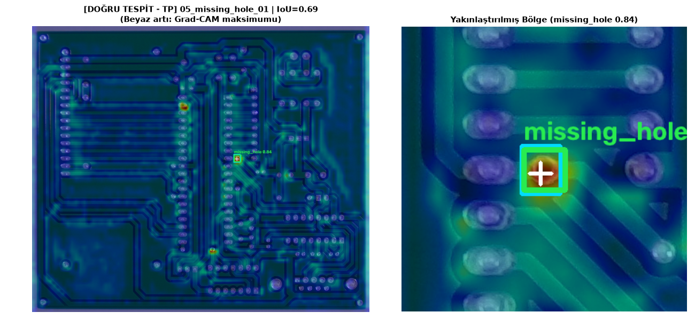

# Tracera: Açıklanabilir ve Edge Uyumlu PCB Hata Tespiti

**Tracera**, baskı devre kartlarındaki (PCB) mikron düzeyindeki 6 sınıf üretim kusurunu (**missing_hole**, **mouse_bite**, **open_circuit**, **short**, **spur**, **spurious_copper**) kart bazlı ayrık veri mimarisiyle tespit eden, kararlarını **LayerCAM (Katman 4)** ile açıklayan ve **OpenVINO INT8** ile CPU üzerinde optimize çalışan uçtan uca bir yapay zeka sistemidir.

> 🌐 **Canlı Web Demosu (Hugging Face Spaces):** `[DEMO_LINKI_YER_TUTUCU]` *(Gradio arayüzü ile test edilebilir).*

---

## 1. Başlık Sonuçları

Model seçiminde ve değerlendirmede aşırı iyimser tekil split yanılgısını önlemek amacıyla birincil başlık metriği olarak **kart bazlı 5-katlı çapraz doğrulama (5-Fold Grouped CV)** ortalaması temel alınmıştır:

- **Kart Bazlı 5-Katlı Çapraz Doğrulama (yolo11s @ 1024, last.pt):**
  - **mAP50:** **0.858 ± 0.152** (`0.8575 ± 0.1523`, örneklem $ddof=1$)
  - **mAP50-95:** **0.424 ± 0.119** (`0.4240 ± 0.1188`)
- **Görülmemiş Test Kartları (Tek Seferlik Nihai Değerlendirme — Kart 06 ve 10, 93 görüntü, 469 kusur kutusu):**
  - **mAP50:** **0.9225**
  - **mAP50-95:** **0.4740**
  - **Precision:** 0.9462 (Oracle eşik: 0.569)
  - **Recall:** 0.8577 (Oracle eşik: 0.569)

> **Metodolojik Not:** Test kartları (06 ve 10) çapraz doğrulama katları arasında görece daha kolay olan Kat 5'e denk geldiği için tek seferlik test skoru (0.9225) iyimser uçtadır. Projenin ana teknik iddiası **0.858 ± 0.152** çapraz doğrulama başarımıdır.

---

## 2. Neden Kart Bazlı Bölme? (Veri Sızıntısı Analizi)

Literatürdeki birçok çalışmada PCB görüntüleri rastgele karıştırılarak (%80 eğitim / %20 test) bölünmektedir. Ancak aynı karta ait sentetik kusurlu parçalar hem eğitim hem doğrulama kümelerine dağıldığında, model kartın kendine has arka plan bakır yollarını, lehim maskesi dokusunu ve renk tonunu ezberlemekte; gerçek bir genelleme yapmamaktadır.

Bu sızıntıyı deneysel olarak kanıtlamak için aynı 623 görüntü üzerinde **Rastgele (Random)** ve **Kart Bazlı (Grouped)** 5-katlı çapraz doğrulama kıyaslanmıştır:

| Bölme Şeması | Kat | Doğrulama Kartları | Eğitim / Val Görüntü | mAP50 | mAP50-95 | missing_hole | mouse_bite | open_circuit | short | spur | spurious_copper |
|---|---|---|---|---|---|---|---|---|---|---|---|
| Rastgele (Random Split) | Kat 1 | 01;04;05;06;07;08;09;10;11;12 | 498 / 125 | 0.9416 | 0.5022 | 0.5870 | 0.4556 | 0.5005 | 0.5192 | 0.4492 | 0.5015 |
| Rastgele (Random Split) | Kat 2 | 01;04;05;06;07;08;09;10;11;12 | 498 / 125 | 0.9507 | 0.5088 | 0.5928 | 0.4792 | 0.4567 | 0.5609 | 0.4934 | 0.4695 |
| Rastgele (Random Split) | Kat 3 | 01;04;05;06;07;08;09;10;11;12 | 498 / 125 | 0.9414 | 0.4931 | 0.5493 | 0.5284 | 0.4443 | 0.4794 | 0.4609 | 0.4960 |
| Rastgele (Random Split) | Kat 4 | 01;04;05;06;07;08;09;10;11;12 | 499 / 124 | 0.9185 | 0.4889 | 0.6418 | 0.4503 | 0.4996 | 0.4349 | 0.4428 | 0.4638 |
| Rastgele (Random Split) | Kat 5 | 01;04;05;06;07;08;09;10;11;12 | 499 / 124 | 0.9300 | 0.5009 | 0.6193 | 0.4895 | 0.4850 | 0.4963 | 0.4124 | 0.5029 |
| **Rastgele (Random Split) Ortalama** | **Özet** | **10 Kart (Tümü)** | **623 Toplam** | **0.9364 ± 0.0124** | **0.4988 ± 0.0078** | 0.5980 | 0.4806 | 0.4772 | 0.4981 | 0.4517 | 0.4867 |
|---|---|---|---|---|---|---|---|---|---|---|---|
| Kart Bazlı (Grouped Split) | Kat 1 | 01 | 509 / 114 | 0.5005 | 0.2001 | 0.4456 | 0.1000 | 0.2528 | 0.2163 | 0.0308 | 0.1550 |
| Kart Bazlı (Grouped Split) | Kat 2 | 04;11 | 466 / 157 | 0.8805 | 0.4182 | 0.5331 | 0.4960 | 0.4409 | 0.2381 | 0.3940 | 0.4071 |
| Kart Bazlı (Grouped Split) | Kat 3 | 05;12 | 513 / 110 | 0.8525 | 0.4363 | 0.5571 | 0.4130 | 0.4666 | 0.4960 | 0.4751 | 0.2100 |
| Kart Bazlı (Grouped Split) | Kat 4 | 08;09 | 514 / 109 | 0.8998 | 0.4437 | 0.4765 | 0.3511 | 0.4568 | 0.4380 | 0.4384 | 0.5016 |
| Kart Bazlı (Grouped Split) | Kat 5 | 06;07;10 | 490 / 133 | 0.8974 | 0.4801 | 0.5844 | 0.4613 | 0.4746 | 0.4532 | 0.4475 | 0.4593 |
| **Kart Bazlı (Grouped Split) Ortalama** | **Özet** | **10 Kart (Tümü)** | **623 Toplam** | **0.8061 ± 0.1719** | **0.3957 ± 0.1116** | 0.5193 | 0.3643 | 0.4183 | 0.3683 | 0.3572 | 0.3466 |

> **Deneysel Çıkarım:** Rastgele bölmede mAP50 **0.9364** çıkarken, kart bazlı bölmede model tamamen yabancı kart geometrileriyle karşılaştığında mAP50 **0.8061** seviyesine düşmektedir (**-13.0 puanlık düşüş**). Kat 1'de (sadece Kart 01) model mAP50 = 0.5005 seviyesinde kalmaktadır. Rastgele bölmeyle raporlanan yüksek skorlar sahte bir doğruluk üretmektedir.

---

## 3. Giriş Çözünürlüğü ve Model Seçimi

Mikron düzeyindeki küçük kusurların (mouse bite, spur) kaybolmaması için giriş boyutu 640×640 ve 1024×1024 çözünürlüklerinde 5-katlı kart bazlı çapraz doğrulama ile karşılaştırılmıştır:

| Çözünürlük | Ağırlık Kuralı | Kat 1 | Kat 2 | Kat 3 | Kat 4 | Kat 5 | Ortalama ± std (mAP50) | Ortalama ± std (mAP50-95) | Ortalama Süre (dk) |
|---|---|---|---|---|---|---|---|---|---|
| **640x640** | last.pt (Önceden Kilitli) | 0.5155 | 0.8402 | 0.8565 | 0.8192 | 0.9031 | **0.7869 ± 0.1548** | 0.3760 ± 0.1080 | 11.0 dk |
| **640x640** | best.pt (Bilgi Amaçlı Val Seçimi) | 0.5069 | 0.8716 | 0.8921 | 0.9258 | 0.9031 | **0.8199 ± 0.1761** | 0.4040 ± 0.1080 | 11.0 dk |
| **1024x1024** | last.pt (Önceden Kilitli) | 0.5885 | 0.9080 | 0.8952 | 0.9388 | 0.9569 | **0.8575 ± 0.1523** | 0.4240 ± 0.1188 | 24.8 dk |
| **1024x1024** | best.pt (Bilgi Amaçlı Val Seçimi) | 0.6442 | 0.9248 | 0.9295 | 0.9637 | 0.9546 | **0.8834 ± 0.1347** | 0.4508 ± 0.0938 | 24.8 dk |

1024×1024 çözünürlük 5 katın 5'inde de üstünlük sağlamış (ortalama mAP50 farkı: **+0.0706**, mAP50-95: **+0.0480**), bu nedenle nihai model mimarisi olarak `yolo11s @ 1024` seçilmiştir.

---

## 4. Çalışma Noktası, Hata Analizi ve Şablon Kontrolü

Nesne tespiti modellerinde mAP eşikten bağımsız bir sıralama metriğidir. Gerçek bir kalite kontrol hattında ise tek bir güven eşiği seçilmelidir. Çalışma noktası protokolü gereğince, güven eşiği **test seti görülmeden önce doğrulama (val) kümesinde F1 skoru maksimize edilerek (conf = 0.395, IoU = 0.50)** kilitlenmiştir.

### Sabit Eşik Performansı ve FP Ayrıştırması

| Veri Kümesi Spliti | Güven Eşiği | TP | Toplam FP | Arka Plan FP (IoU<0.1) | Konum Hatası FP | Çift Tespit FP | Yanlış Sınıf FP | FN | Precision | Recall | F1 Skoru |
|---|---|---|---|---|---|---|---|---|---|---|---|
| Doğrulama (Val: Kart 05, 11) | 0.395 | 514 | 16 | 7 | 7 | 2 | 0 | 48 | 0.9698 | 0.9146 | **0.9414** |
| Test (Kilitli: Kart 06, 10) | 0.395 | 416 | 142 | 125 | 8 | 4 | 5 | 53 | 0.7455 | 0.8870 | **0.8101** |
| **Test (Duyarlılık: 2 Şablon Noktası Hariç)** | 0.395 | 416 | 28 | 11 | 8 | 4 | 5 | 53 | **0.9369** | 0.8870 | **0.9113** |

### Hata Analizi: 2 Sabit Şablon Noktası
Test setindeki 142 yanlış pozitifin (FP) 138'i tek bir kartta (**Kart 06**) kümelenmiştir (Kart 10'da sadece 4 FP vardır).
Bu 138 FP incelendiğinde, 114 tanesinin şablon görüntüsündeki **2 sabit koordinatta** tekrarlanan yol geometrisi özellikleri olduğu tespit edilmiştir:
1. `mouse_bite` @ $(x \approx 1001, y \approx 1380)$: 57 farklı test görüntüsünde 57 kez yanlış alarm vermiştir (güven: 0.44–0.63).
2. `spur` @ $(x \approx 1708, y \approx 1050)$: 57 farklı test görüntüsünde 57 kez yanlış alarm vermiştir (güven: 0.40–0.46).

### Temiz Şablon Kontrolü (Doğrulama)
Hatanın kaynağını doğrulamak için model hatasız şablon kartları üzerinde (`PCB_USED/05, 06, 10, 11.JPG`) çalıştırılmıştır:

| Kart No | Şablon Dosyası | Yanlış Alarm Sınıfı | Model Güveni | Koordinatlar (cx, cy) | Teşhis |
|---|---|---|---|---|---|
| Kart 05 | `05.JPG` | spurious_copper | 0.5108 | (1606.5, 1072.9) | Arka Plan Dokusu |
| Kart 05 | `05.JPG` | spurious_copper | 0.4475 | (1537.1, 1183.2) | Arka Plan Dokusu |
| Kart 06 | `06.JPG` | mouse_bite | 0.5569 | (1000.6, 1380.1) | **Şablon Özelliği (Test FP noktasıyla birebir örtüşüyor)** |

Kart 06'nın hatasız temiz şablonunda `mouse_bite` noktasının **0.5569** güven ile alarm vermesi, bu noktanın sentetik kusur ekleme işleminden değil, kartın orijinal tasarım şablonundaki daralmadan kaynaklandığını **kesin** olarak doğrulamıştır. Bu 2 sabit nokta çıkarıldığında test kümesi Precision skoru **0.9369**, F1 skoru **0.9113** seviyesine yükselmektedir.

---

## 5. Açıklanabilir Yapay Zeka (XAI) Doğrulama Protokolü

Endüstriyel denetimde modelin doğru tahmini doğru nedenden ötürü yapıp yapmadığını kanıtlamak amacıyla tespit bazlı CAM yöntemleri karşılaştırmalı olarak doğrulanmıştır.


*Şekil 1: LayerCAM @ Katman 4 ile üretilen ısı haritası ve 4× yakınlaştırılmış kusur bölgesi (val kümesi Kart 05 missing_hole tespiti).*

### Pointing Game ve Enerji Oranı

| Hedef Katman | Yöntem | Kendi Kutu Pointing (Eğitilmiş) | Pointing (Rastgele Model) | Rastgele Şans Oranı | Pencere Alan Oranı | Kutu İçi Enerji (Pencere İçi) | Taban Kutu Alan Oranı |
|---|---|---|---|---|---|---|---|
| Katman 4 | gradcam | 6.7% | 0.7% | 0.106% | 100.0% | 0.5% | 0.110% |
| Katman 4 | hirescam | 88.0% | 62.0% | 0.106% | 100.0% | 33.7% | 0.110% |
| Katman 4 | layercam | 90.7% | 68.0% | 0.106% | 100.0% | **61.0%** | 0.110% |
| Katman 16 | layercam | 100.0% | 68.0% | 0.106% | 0.2% | 92.9% | 51.960% |

### Mutlak Bütçeli Yapısal Silme Testi (Asıl Sadakat Ölçüsü)

| Hedef Katman | Yöntem | 1x GT Alanı Harita Göreli Düşüş (Ort / Med) | 1x Kontrol Düşüşü (Ort / Med) | 1x Kazanma Oranı | 2x GT Alanı Harita Göreli Düşüş (Ort / Med) | 2x Kontrol Düşüşü (Ort / Med) | 2x Kazanma Oranı |
|---|---|---|---|---|---|---|---|
| Katman 4 | gradcam | 0.0433 / 0.0007 | 0.0132 / 0.0001 | 62.0% | 0.0849 / 0.0016 | 0.0255 / 0.0004 | 65.3% |
| Katman 4 | hirescam | 0.7725 / 0.9858 | 0.0009 / 0.0000 | 98.7% | 0.8728 / 0.9999 | 0.0054 / 0.0000 | 99.3% |
| Katman 4 | layercam | 0.7004 / 0.9752 | 0.0023 / 0.0000 | **97.3%** | 0.7654 / 0.9978 | 0.0172 / 0.0001 | **98.7%** |
| Katman 16 | layercam | 0.7623 / 1.0000 | 0.7538 / 0.9324 | 58.7% | 0.8750 / 1.0000 | 0.8344 / 0.9999 | 60.7% |

### Neden Klasik Grad-CAM Değil ve Neden LayerCAM @ Katman 4?
1. **Grad-CAM Yetersizliği:** Klasik Grad-CAM gradyanların uzamsal ortalamasını aldığından, YOLO gibi tek öznitelik haritasında birden fazla tespit üreten modellerde sinyali seyreltir. Silme testinde ortalama skor düşüşü sadece 0.0433'te kalmış, kontrolün üzerine belirgin bir etki koyamamıştır.
2. **HiResCAM vs. LayerCAM:** HiResCAM silme testinde yüksek sadakat gösterse de gradyanları süzmediği için kutu içi enerji oranı %33.7'de kalmakta, harita alakasız arka plan piksellerine taşmaktadır. LayerCAM ise gradyanları pozitif yönde eleyerek enerjinin **%61.0**'ını kusur kutusuna odaklamakta ve silme testinde %97.3 kazanma oranı sağlamaktadır.
3. **Katman 4 (Backbone Stride 8):** Katman 16 boyun seviyesinde olduğundan uzamsal çözünürlüğü kabadır; silme testinde rastgele kaydırılan kontrol maskesi dahi kutuya taşarak düşüş üretmektedir. Mikron düzeyindeki PCB kusurlarında yerel sadakat Katman 4 ile elde edilmiştir.
4. **Adebayo Randomizasyon Testi:** Rastgele ağırlıklı modelde pointing oranının %68 çıkması, pointing testinin model öğrenmesinden çok evrişimli mimarinin uzamsal türevlenebilirliğini yansıttığını göstermiştir. Bu nedenle asıl sadakat metriği olarak mutlak bütçeli yapısal silme testi benimsenmiştir.

---

## 6. Kenar ve Donanım Çıkarım Başarımı

Tüm hız testleri **laptop ortamında** (AMD Ryzen 7 8845HS CPU ve NVIDIA GeForce RTX 4060 Laptop GPU) doğrulanmış olup gömülü kenar cihaz iddiası yapılmamaktadır:

| Model & Çözünürlük | Format / Çalışma Zamanı | Donanım | Model Boyutu | Model Çıkarım Gecikmesi (Ort / Med ms) | Uçtan Uca Gecikme (Ort / Med ms) | FPS (Uçtan Uca) | mAP50 | mAP50-95 |
|---|---|---|---|---|---|---|---|---|
| `g_y11s_640_full` | PyTorch FP32 (GPU) | GPU (RTX 4060 Laptop) | 18.3 MB | 8.89 / 8.78 ms | 12.10 / 11.97 ms | **83.5** | 0.9005 | 0.4214 |
| `g_y11s_640_full` | ONNX Runtime (CPU) | CPU (Ryzen 7 8845HS) | 36.2 MB | 54.74 / 54.68 ms | 58.49 / 58.44 ms | **17.1** | 0.8995 | 0.4173 |
| `g_y11s_640_full` | OpenVINO FP32 (CPU) | CPU (Ryzen 7 8845HS) | 36.3 MB | 37.84 / 36.48 ms | 41.15 / 39.87 ms | **25.1** | 0.8995 | 0.4173 |
| `g_y11s_640_full` | OpenVINO INT8 (CPU) | CPU (Ryzen 7 8845HS) | 9.8 MB | 14.08 / 13.60 ms | 17.40 / 16.83 ms | **59.4** | 0.8975 | 0.4164 |
| `g_y11s_1024_full` | PyTorch FP32 (GPU) | GPU (RTX 4060 Laptop) | 18.4 MB | 9.74 / 9.80 ms | 15.02 / 14.83 ms | **67.4** | 0.9396 | 0.4434 |
| `g_y11s_1024_full` | ONNX Runtime (CPU) | CPU (Ryzen 7 8845HS) | 36.4 MB | 157.45 / 157.18 ms | 165.31 / 165.00 ms | **6.1** | 0.9372 | 0.4378 |
| `g_y11s_1024_full` | OpenVINO FP32 (CPU) | CPU (Ryzen 7 8845HS) | 36.5 MB | 105.18 / 103.06 ms | 111.68 / 109.70 ms | **9.1** | 0.9372 | 0.4378 |
| `g_y11s_1024_full` | OpenVINO INT8 (CPU) | CPU (Ryzen 7 8845HS) | 10.0 MB | 37.32 / 36.70 ms | 43.89 / 43.73 ms | **22.9** | 0.9430 | 0.4569 |
| `g_y11s_640_full` | TensorRT FP16 (GPU) | GPU (RTX 4060 Laptop) | 21.5 MB | 1.86 / 1.86 ms | 5.18 / 5.18 ms | **193.0** | 0.9003 | 0.4155 |
| `g_y11s_1024_full` | TensorRT FP16 (GPU) | GPU (RTX 4060 Laptop) | 22.1 MB | 3.36 / 3.34 ms | 12.19 / 12.29 ms | **81.4** | 0.9372 | 0.4382 |

- **OpenVINO INT8 (CPU):** 1024×1024 çözünürlükte CPU çıkarımını 105.2 ms'den **37.3 ms**'ye düşürmüş (~2.8× hızlanma), model boyutunu 10.0 MB'a indirmiştir. mAP kaybı yaşanmamıştır (120 görüntülük val setindeki +0.6 puanlık oynama ölçüm gürültüsüdür; doğruluk korunmuştur).
- **TensorRT FP16 (GPU):** 1024×1024'te çıkarımı **3.34 ms**'ye indirmiş, uçtan uca 81.4 FPS hız sağlamıştır.

---

## 7. Endüstriyel PCB-AoI Transfer Deneyi (Null Sonuç)

PKU veri kümesinde öğrenilen temsillerin gerçek endüstriyel PCB-AoI verisine transfer edilebilirliği, standart COCO ağırlıkları ile karşılaştırılarak test edilmiştir (100 epoch, batch 16, imgsz 640, 3 seed, last.pt):

| Başlangıç Modeli | Seed | Eğitim Süresi | Test mAP50 | Test mAP50-95 | Bad_qiaojiao mAP50 | Bad_podu mAP50 |
|---|---|---|---|---|---|---|
| COCO (yolo11s.pt) | Seed 0 | 5.97 dk | 0.6035 | 0.2082 | 0.3750 | 0.8321 |
| COCO (yolo11s.pt) | Seed 1 | 15.62 dk | 0.6107 | 0.2133 | 0.3793 | 0.8422 |
| COCO (yolo11s.pt) | Seed 2 | 5.27 dk | 0.6108 | 0.2099 | 0.4193 | 0.8023 |
| PKU (g_y11s_1024_full) | Seed 0 | 5.11 dk | 0.6283 | 0.2212 | 0.4134 | 0.8433 |
| PKU (g_y11s_1024_full) | Seed 1 | 5.19 dk | 0.6402 | 0.2267 | 0.4531 | 0.8273 |
| PKU (g_y11s_1024_full) | Seed 2 | 5.80 dk | 0.5831 | 0.2084 | 0.3425 | 0.8237 |
| **COCO (yolo11s.pt) Ortalama** | **Özet (ddof=1)** | **8.95 dk** | **0.6083 ± 0.0042** | **0.2105 ± 0.0026** | **0.3912 ± 0.0244** | **0.8255 ± 0.0207** |
| **PKU (g_y11s_1024_full) Ortalama** | **Özet (ddof=1)** | **5.37 dk** | **0.6172 ± 0.0301** | **0.2188 ± 0.0094** | **0.4030 ± 0.0560** | **0.8314 ± 0.0104** |

> **Bilimsel Çıkarım (Null Sonuç):** PKU başlangıcının test mAP50 ortalaması 0.6172 ± 0.0301 iken COCO başlangıcı 0.6083 ± 0.0042 seviyesindedir. Eşleştirilmiş fark (+0.0089 ± 0.0318) seed varyansının içindedir ($n=3$). Bu deney bir **null sonuç** olarak raporlanmıştır; PKU ön eğitiminin farklı aydınlatma ve optik koşullara sahip AoI verisinde anlamlı bir avantaj sağladığı gösterilememiştir.

---

## 8. Sınırlılıklar ve Açık Noktalar

1. **Çözünürlük Çapraz Doğrulaması Bilgisi:** Giriş çözünürlüğü CV deneyi (Tablo 2), rastgele bölmenin train+val görüntüleri (623 görüntü) üzerinde yürütüldüğü için dolaylı olarak test kartlarının (06 ve 10) bazı görüntülerini içermiştir. Ancak nihai model eğitimi (train kümesindeki 6 kart) bu test kartlarından kesinlikle izole tutulmuştur.
2. **Kısıtlı Test Arka Planı:** PKU veri kümesinde bağımsız istatistiksel birim görüntü değil **kart tasarımıdır** (10 adet tasarım). Test kümesi fiilen yalnızca 2 kart tasarımından (06 ve 10) oluştuğu için sonuçlar tüm olası endüstriyel kart tasarımlarını temsil etmeyebilir.
3. **Spur Yanlış Alarmı Davranışı:** Kart 06 temiz şablonunda `spur` noktası eşiğin çok altında kalırken (0.09), hatalı görüntülerde neden eşik üstüne (0.40–0.46) çıktığının kesin fiziksel nedeni kanıtlanamamıştır (olası sıkıştırma/kayıt farkı test edilmemiştir).
4. **AoI Veri Kümesi Kısıtları:** PCB-AoI transfer veri kümesi küçük (142 görüntü) ve etiket gürültüsüne sahiptir; doğrulama kümesindeki köprü hatası kutu sayısı az olduğu için seed'ler arası dalgalanma yüksektir.
5. **Donanım Kapsamı:** Tüm gecikme ve hız metrikleri dizüstü bilgisayar bileşenleri (Ryzen 7 8845HS / RTX 4060 Laptop GPU) üzerinde elde edilmiştir; endüstriyel gömülü kartlarda (Jetson, edge TPU) doğrudan aynı hızları garanti etmez.

---

## 9. Projeyi Çalıştırma

### Ortam Kurulumu (Conda)
```bash
conda create -n tracera python=3.11 -y
conda activate tracera
pip install -r app/requirements.txt
```

### Deneylerin Sırayla Çalıştırılması
```bash
# 1. Veri hazırlığı ve kart bazlı ayrıştırma
python data/prepare_yolo.py

# 2. Sızıntı ve çözünürlük çapraz doğrulamaları
python scripts/cv_leakage.py
python scripts/cv_resolution.py

# 3. 1024x1024 nihai model eğitimi (last.pt)
python scripts/train_final.py

# 4. Değerlendirme, hata analizi ve şablon kontrolü
python scripts/evaluate.py
python scripts/error_analysis.py

# 5. XAI LayerCAM doğrulama ve silme testleri
python scripts/gradcam.py --method layercam --layer 4

# 6. Kenar formatları dışa aktarma ve benchmark
python scripts/benchmark_edge.py

# 7. PCB-AoI transfer öğrenme deneyi
python scripts/aoi_transfer.py

# 8. Dağıtım paketi oluşturma ve izole test
python scripts/build_space.py

# 9. Web arayüzünü yerel olarak başlatma
python app/app.py
```

### Docker ile Çalıştırma
```bash
# Dağıtım paketini inşa et
python scripts/build_space.py

# Docker imajını oluştur ve çalıştır
docker build -t tracera-app .
docker run -p 7860:7860 tracera-app
```
Tarayıcınızdan `http://localhost:7860` adresine gidin.

---

## 10. Veri Kaynakları ve Lisans

- **PKU-Market-PCB Veri Kümesi:** Tang vd. (Pekin Üniversitesi) tarafından sağlanan 1386 görüntülük açık PCB hata tespiti veri kümesi.
- **DeepPCB / PCB-AoI Veri Kümesi:** Endüstriyel yüzey montaj kusurlarını içeren açık araştırma seti.
- **Lisans:** `[LISANS_TURU_KULLANICI_SECIMI]` *(Kullanıcı tarafından belirlenecektir).*

---

## English Summary

**Tracera** is an explainable and edge-optimized PCB defect detection system focused on 6 microscopic manufacturing defect classes. Addressing the widespread data leakage problem in random split setups, Tracera enforces a rigorous **grouped split (card-based partitioning)** where test cards are never seen during training. Key findings:
- **Primary Result:** 5-Fold Grouped Cross-Validation achieves **0.858 ± 0.152** mAP50 at 1024×1024 with `last.pt`, outperforming 640×640 on 5/5 folds. Single-shot unseen test evaluation yields **0.9225** mAP50.
- **Operating Point & Error Analysis:** Calibrated at val F1-max (conf = 0.395), the test F1 is 0.8101. Error analysis reveals 114 out of 142 false alarms originate from 2 invariant baseline copper trace patterns on board 06 (confirmed on clean template images). Excluding these 2 template points yields **0.9113** F1 score (0.9369 Precision).
- **Explainable AI (XAI):** Standard Grad-CAM fails deletion fidelity tests on YOLO architectures. **LayerCAM at Backbone Layer 4 (Stride 8)** concentrates 61.0% activation energy inside the ground truth box and achieves a **97.3% win rate** in absolute budget structural deletion tests.
- **Edge Deployment:** OpenVINO INT8 quantization accelerates CPU inference by ~2.8× (from 105.2 ms to **37.3 ms**) and compresses the model to 10.0 MB on an AMD Ryzen 7 8845HS laptop CPU with zero loss in mAP50.
- **Transfer Learning:** Transfer experiments to real industrial PCB-AoI images yielded a **null result** (PKU pre-training 0.617 ± 0.030 vs COCO 0.608 ± 0.004 mAP50, within seed noise), openly documenting domain transfer boundaries.
